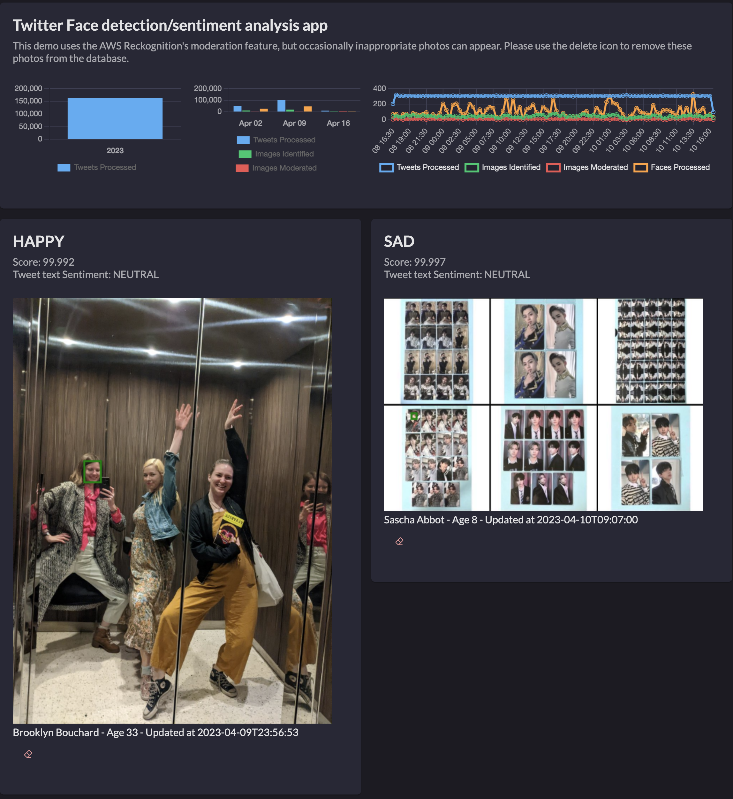
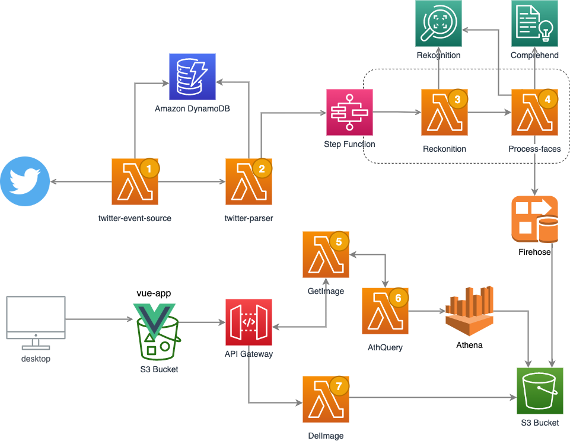

# AWS Serverless Face Recognition Sentiment Analysis on Twitter



This serverless application analyzes emotions from Twitter images using [Amazon Rekognition](https://aws.amazon.com/rekognition/). It creates a ranking of the happiest, saddest, and other emotions detected from tweets containing the word "selfie". The app uses Lambda functions to extract, process, store, and report information from images.

⚠️ **Important**: Twitter is a public platform without photo moderation. While this demo uses AWS Rekognition's moderation features, inappropriate content may occasionally appear. **Use at your own discretion**.

## Architecture



### Key Features

- **Automated Data Lifecycle**: S3 bucket includes [Object Lifecycle Management](https://docs.aws.amazon.com/AmazonS3/latest/dev/object-lifecycle-mgmt.html) that expires reports and records after 2 days
- **DynamoDB TTL**: All processed image records automatically expire after 2 days
- **CloudWatch Metrics**: Uses [Embedded Metric Format](https://docs.aws.amazon.com/AmazonCloudWatch/latest/monitoring/CloudWatch_Embedded_Metric_Format_Specification.html) to track:
  - Number of tweets processed
  - Images moderated
  - Faces identified and analyzed
- **Performance Monitoring**: [AWS X-Ray](https://aws.amazon.com/xray/) integration for application performance insights and troubleshooting

> **Note**: There's no direct correlation between tweet count and faces processed, as not all images contain people, some are moderated, and single images may contain multiple faces.

## Prerequisites

This application is deployed using AWS SAM with a Vue.js frontend. You'll need:

- [AWS SAM CLI](https://aws.amazon.com/serverless/sam/) - For building and deploying serverless applications
- [Node.js and npm](https://nodejs.org/) - For building the Vue.js application
- [AWS CLI](https://docs.aws.amazon.com/cli/latest/userguide/cli-chap-install.html) - For AWS resource management
- AWS Account with appropriate permissions
- Python 3.8+ or Docker for Lambda function builds

### Step 1: Create Twitter API Keys

1. The solution requires the following Twitter API Keys: Consumer Key (API Key), Consumer Secret (API Secret), Access Token, and Access Token Secret. Follow these steps to register the app with your Twitter account:
   - Create a Twitter account if you don't already have one
   - Register a new application with your Twitter account:
     - Go to https://developer.twitter.com/en/portal/projects-and-apps
     - Click "Create New App"
     - Under Name, enter something descriptive (but unique), e.g., aws-serverless-twitter-es
     - Enter a description
     - Under Website, you can enter https://github.com/awslabs/aws-serverless-twitter-event-source
     - Leave Callback URL blank
     - Read and agree to the Twitter Developer Agreement
     - Click "Create your Twitter application"
   - (Optional, but recommended) Restrict the application permissions to read only:
     - From the detail page of your Twitter application, click the "Permissions" tab
     - Under the "Access" section, make sure "Read only" is selected and click "Update Settings"
   - Generate an access token:
     - From the detail page of your Twitter application, click the "Keys and Access Tokens" tab
     - On this tab, you will see the Consumer Key (API Key) and Consumer Secret (API Secret) values
     - Scroll down to the Access Token section and click "Create my access token"
     - You will now have the Access Token and Access Token Secret values required by the app

2. Store the keys as encrypted SecureString values in SSM Parameter Store using the AWS Console or these AWS CLI commands:
   
 ```bash
aws ssm put-parameter --name /twitter-event-source/consumer_key --value <your consumer key value> --type SecureString --overwrite
aws ssm put-parameter --name /twitter-event-source/consumer_secret --value <your consumer secret value> --type SecureString --overwrite
aws ssm put-parameter --name /twitter-event-source/access_token --value <your access token value> --type SecureString --overwrite
aws ssm put-parameter --name /twitter-event-source/access_token_secret --value <your access token secret value> --type SecureString --overwrite
  ```

### Step 2: Build all the solution's libraries dependencies

1. The AWS Lambda functions requires libraries for their executions and SAM fetches and install them per each funtion. The *sam build* command creates a .aws-sam directory with the AWS SAM template, AWS Lambda function code, and any language-specific files and dependencies in a format ready to be deployed in the next step. 
   
If you have Python 3.8 installed in your machine you can run:
   
```bash
sam build
```

Another option is to execute *sam build* using containers. It requires you to have docker installed :
```bash
sam build --use-container --build-image amazon/aws-sam-cli-build-image-python3.8
```

When the build finishes, you will receive a message like: 
```bash
Build Succeeded

Built Artifacts  : .aws-sam/build
Built Template   : .aws-sam/build/template.yaml

Commands you can use next
=========================
[*] Validate SAM template: sam validate
[*] Invoke Function: sam local invoke
[*] Test Function in the Cloud: sam sync --stack-name {{stack-name}} --watch
[*] Deploy: sam deploy --guided
```


### Step 3: Deploy the backend usins *sam deploy* 

1. Now it is time to deploy the solution to your AWS Account. The command will ask you a few questions. Below an example of the questions and answers you can provide. Make sure you selecte a region that [Amazon Rekognition](https://docs.aws.amazon.com/general/latest/gr/rekognition.html) supports *DetectModerationLabels* and *DetectFaces* APIs.  
```bash
sam deploy --guided --capabilities CAPABILITY_NAMED_IAM

Configuring SAM deploy
======================

	Looking for config file [samconfig.toml] :  Not found

	Setting default arguments for 'sam deploy'
	=========================================
	Stack Name [sam-app]: twitter-demo
	AWS Region [us-west-2]:
	Parameter GlueDatabaseName [twitter-db]:
	Parameter SearchText [selfie]:
	Parameter SSMParameterPrefix [twitter-event-source]:
	Parameter PollingFrequencyInMinutes [10]:
	Parameter BatchSize [15]:
	#Shows you resources changes to be deployed and require a 'Y' to initiate deploy
	Confirm changes before deploy [y/N]: y
	#SAM needs permission to be able to create roles to connect to the resources in your template
	Allow SAM CLI IAM role creation [Y/n]: y
	#Preserves the state of previously provisioned resources when an operation fails
	Disable rollback [y/N]: n
	GetStat may not have authorization defined, Is this okay? [y/N]: y
	GetImage may not have authorization defined, Is this okay? [y/N]: y
	DelImage may not have authorization defined, Is this okay? [y/N]: y
	Save arguments to configuration file [Y/n]: y
	SAM configuration file [samconfig.toml]:
	SAM configuration environment [default]:
```

Once AWS SAM deploy does it magic, all you need is to answer **Y** to proceed the deployment.

```bash
Previewing CloudFormation changeset before deployment
======================================================
Deploy this changeset? [y/N]: y
```

### Step 4: Deploy Vue.js app into S3

1. In this last step we will executes the script to publish the Vue.js application into your bucket that exposes it via Amazon Cloudfront. **The script requires the npm and aws cli installed**
```bash
./appDeploy.sh 
```

Once if finishes the script provides you the URL where the applicaton is running. Give it a few minutes so the solution can collect some data and transform it into parquet format. 

```bash
Site available at: https://<YourCloudFrontId>.cloudfront.net
```

:warning: **Important Note: Some Ad blocking apps can prevent the images to be shown.** 
